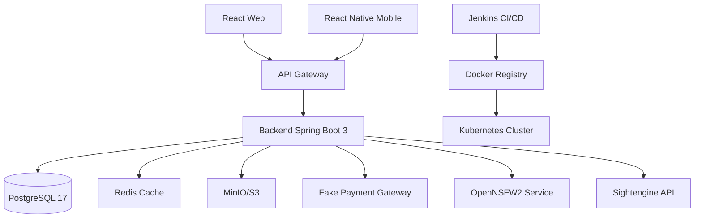

<div align="center">

# 👨‍💻 Cristofer David Lozano Contreras

[](https://git.io/typing-svg)

**Líder de Capysoft** | Neiva, Huila, Colombia 🇨🇴

Estudiante de Análisis y Desarrollo de Software (ADSO) en el SENA, 2024–2026

[](mailto:cristoferlozano233@gmail.com)
[](https://www.linkedin.com/in/cristofer-lozano-490918385)
[](https://github.com/lozano2303)
[](https://github.com/lozano2303)

</div>

---

## 👨‍💻 Sobre mí

```typescript
const cristofer = {
    ubicacion: "Neiva, Huila 🇨🇴",
    rol: "Backend Developer Junior",
    empresa: "Capysoft (Team Lead)",
    educacion: "ADSO - SENA (2024-2026)",
    experiencia: ["Tensometálicas"],
    idiomas: ["Español (Nativo)", "Inglés (B1/B2)"],
    
    workflow: [
        "rama → Liquibase → dominio → infraestructura → aplicación → REST",
        "Validación con Swagger + pruebas end-to-end",
        "IA como herramienta (reviso, pruebo y corrijo)"
    ],
    
    filosofia: "Entender el porqué arquitectónico antes de implementar",
    
    actualmente_aprendiendo: ["Kubernetes avanzado", "Event-Driven Architecture"],
    dato_curioso: "Mi primer proyecto tenía commits como 'hasheo funcional' 😅"
};
```

<details>
<summary>📈 Experiencia previa</summary>

### Tensometálicas
Experiencia laboral en el sector industrial antes de enfocarme en desarrollo de software.

</details>

---

## 🛠️ Stack Tecnológico

<div align="center">

### Backend


### DevOps & Cloud


### Frontend & Móvil


### Herramientas & Otros


### Del primer año 🎓


</div>

<details>
<summary>🔧 Stack detallado</summary>

#### Backend
- **Java 23**, **Spring Boot 3** con arquitectura **DDD hexagonal** (puertos y adaptadores)
- **Spring Security** (JWT + OAuth2), **WebSocket** (STOMP + SockJS)
- **PostgreSQL 17**, **MySQL** para proyectos legacy
- **Liquibase** para versionado de esquema de base de datos

#### DevOps & Infrastructure
- **Docker** para contenedorización
- **Kubernetes** para orquestación de contenedores
- **Jenkins** para CI/CD pipelines
- **AWS S3**, **MinIO** para almacenamiento de objetos
- **SonarQube** para análisis de calidad de código

#### Frontend & Mobile
- **React 18** + **Vite** + **Tailwind CSS** para web
- **React Native** + **Expo** para aplicaciones móviles
- **Konva** para gráficos 2D interactivos

#### Primer año ADSO
- **PHP** + **PHPMailer** para backend
- **JavaScript** vanilla para lógica del cliente
- **HTML5**, **CSS3**, **Bootstrap 5** para UI

</details>

---

## 🚀 Proyecto Principal: Tu Evento

<div align="center">

[](https://github.com/lozano2303/TuEvento)
[](https://github.com/lozano2303/TuEvento/stargazers)
[](https://github.com/lozano2303/TuEvento/commits)
[](https://github.com/lozano2303/TuEvento)

[&color=success)](https://github.com/lozano2303/TuEvento/commits)
[-blue?style=flat-square&logo=git)](https://github.com/lozano2303/TuEvento/tree/develop)
[](https://github.com/lozano2303/TuEvento/graphs/contributors)

**Plataforma full-stack de gestión de eventos y venta de boletas**

Desarrollada con **Capysoft** · Backend **Spring Boot 3** con **DDD hexagonal** · Web **React** · Móvil **React Native + Expo**

</div>

### 🎯 Arquitectura del Proyecto



### ✨ Lo construido

### 📊 Highlights Técnicos

<table>
<tr>
<td width="50%">

#### 🎨 Frontend
- ✅ Editor visual 2D con Konva
- ✅ WebSocket real-time
- ✅ Paginación optimizada
- ✅ Temas personalizables
- ✅ Responsive design

</td>
<td width="50%">

#### ⚙️ Backend
- ✅ DDD + Hexagonal
- ✅ Event-Driven
- ✅ CI/CD completo
- ✅ Moderation Pipeline
- ✅ Payment Strategy Pattern

</td>
</tr>
</table>

---

<details>
<summary><b>🎨 Editor visual 2D de recintos</b></summary>

- Canvas interactivo con **Konva** para diseñar distribuciones de venues
- Drag & drop, selección rubber-band, snap guides, edición de polígonos con vértices Bézier
- Distribución automática de sillas con `distributeSeats`, `computePolygonSeatRows`
- Integrado con el backend para persistir layouts en JSONB

</details>

<details>
<summary><b>⚡ Selección de sillas en tiempo real</b></summary>

- **WebSocket** (STOMP + SockJS) para sincronización de estado de sillas
- Reserva temporal de **10 minutos** con expiración automática vía scheduler (`@Scheduled` cada 10 seg)
- Carrito con cuenta regresiva en frontend (React `setInterval`) que libera reservas al expirar
- Mapa paginado 10×10 con zoom animado, verificado con evento de ~999 sillas

</details>

<details>
<summary><b>🎟️ Módulo de tickets</b></summary>

- Órdenes con máquina de estados, generación de QR, check-in, auditoría completa
- Tablas: `ticket`, `ticket_log`, `ticket_checkin`, `seat_ticket`

</details>

<details>
<summary><b>💳 Pagos con patrón Strategy</b></summary>

- Microservicio **fake-payment-gateway** independiente (Spring Boot, estructura DDD completa)
- Webhooks firmados con **HMAC-SHA256**, idempotencia, reintentos con backoff exponencial
- Diseñado para cambiar a pasarela real (ej. Wompi) sin tocar la lógica del core

</details>

<details>
<summary><b>💰 Reembolsos y wallet</b></summary>

- Billetera digital con transacciones de recarga, pago, retiro, reembolso
- **Pago mixto wallet + pasarela**: lógica implementada en `ChargeOrderViaGatewayUseCase`, cobra solo el delta por gateway
- Manejo de reservas huérfanas ante fallos de integración

</details>

<details>
<summary><b>🛡️ Moderación de imágenes en dos capas</b></summary>

- **OpenNSFW2** autoalojado (FastAPI, TensorFlow 2.12, modelo pinned `opennsfw2==0.10.2`)
- **Sightengine** como segunda capa (evalúa gore, nudity, weapons); fail-open sin credenciales
- Orquestado en cascade: OpenNSFW2 primero → Sightengine solo si pasa etapa 1

</details>

<details>
<summary><b>🎨 Temas personalizables</b></summary>

- Sistema de temas (light, dark, purple, blue) con customización a nivel de propiedad
- Disponible en web y móvil

</details>

<details>
<summary><b>🔔 Módulo de notificaciones</b> <i>(en desarrollo)</i></summary>

- Canales configurables: email (SMTP) y push
- Estado de entrega: Pending, Sent, Delivered, Failed

</details>

<details>
<summary><b>🌍 Internacionalización</b> <i>(en desarrollo)</i></summary>

- Soporte para ES, EN, PT, JA con capa de traducción aplicada a entidades del dominio

</details>

<details>
<summary><b>📚 Documentación</b></summary>

- Manual de usuario web (formato APA 7)
- Plan de pruebas y matriz de casos de prueba

</details>

---

### 🔄 De dónde venimos

<table>
<tr>
<td width="50%" align="center">

**Versión Anterior**

[](https://github.com/lozano2303/tu-evento)

Arquitectura básica  
Sin pipeline CI/CD  
Sin DDD

</td>
<td width="50%" align="center">

**Versión Actual**

[](https://github.com/lozano2303/TuEvento)

**DDD + Hexagonal**  
**Jenkins + K8s + SonarQube**  
**Modular N-Layer**

</td>
</tr>
</table>

La versión anterior fue **completamente refactorizada** a **arquitectura N-Layer con DDD** (RF21). Se agregó un **pipeline CI/CD completo** con Jenkins, SonarQube, Docker y Kubernetes para pruebas automatizadas, análisis de calidad y despliegue continuo.

> **💡 Nota sobre desarrollo:** El trabajo activo de TuEvento se realiza en la rama `develop` siguiendo GitFlow. Los merges a `main` se hacen por releases completos. Para ver la actividad reciente, revisa [los commits en develop](https://github.com/lozano2303/TuEvento/commits/develop).

---

## 🎓 Trayectoria

### 🎮 Juego web multijugador (primer año ADSO)

<div align="center">

[](https://github.com/KeinerNarvaez/Proyecto-juego)
[](#)
[](#)

**Exposición:** 📅 6 de diciembre, 2024 | 📍 Cámara de Comercio de Neiva, Huila

</div>

**Tecnologías:** 


<details>
<summary><b>📋 Funcionalidades del juego</b></summary>

- 🔐 Sistema completo de autenticación
- 🎯 Modo solitario con 9 niveles (5 pociones + 4 hechizos)
- 🎮 Salas multijugador (crear y unirse)
- 💬 Chat en tiempo real
- 👤 Sistema de avatares
- 🎵 Audio y música
- 📧 Notificaciones por correo

</details>

### 💼 Mi contribución (14 commits)

<table>
<tr>
<td width="33%" align="center">

**🔐 Autenticación**

✅ Registro con hash  
✅ Activación por correo  
✅ Login seguro  
✅ Recuperación de contraseña  
✅ 2FA con códigos

</td>
<td width="33%" align="center">

**🎮 Modo Solitario**

✅ 5 niveles de pociones  
✅ 4 niveles de hechizos  
✅ Sistema de progresión  
✅ Historial de partidas  
✅ Función "Continuar"

</td>
<td width="33%" align="center">

**🗄️ Base de Datos**

✅ Migración PostgreSQL → MySQL  
✅ 8+ tablas relacionales  
✅ PDO con prepared statements  
✅ Integridad referencial

</td>
</tr>
</table>

<details>
<summary><b>📊 Detalles de mi trabajo</b></summary>

#### Fase 1: Sistema de Autenticación (Sep 28 - Oct 10, 2024)
- Conexión a base de datos con PDO
- Estructura completa de BD (migración PostgreSQL → MySQL)
- Hash de contraseñas con `password_hash()`
- Activación de cuentas por correo
- Integración completa de **PHPMailer** (9,427 líneas agregadas)
- Sistema de login con validación
- Recuperación de contraseñas
- Verificación en dos pasos (2FA)

#### Fase 2: Modo Solitario (Dic 4-5, 2024)
- 9 niveles jugables (5 pociones + 4 hechizos)
- Sistema de progresión persistente
- Historial de mejores puntajes y derrotas
- Gestión de niveles (eliminación, consulta)
- Función "Continuar" desde último nivel jugado
- APIs internas para comunicación frontend-backend

**Total:** ~1,229 líneas netas de código propio (sin contar PHPMailer)

</details>

### 📈 Evolución profesional

<table>
<tr>
<td width="50%">

#### 🎮 Proyecto del primer año
```php
// Commit: "hasheo funcional"
if ($password == $dbPassword) {
    // Login success
}
```
❌ Sin arquitectura clara  
❌ Commits poco descriptivos  
❌ Código sin separación de capas

</td>
<td width="50%">

#### 🚀 Tu Evento (hoy)
```java
// Commit: "feat(auth): implement JWT refresh token rotation"
@UseCase
public class RefreshTokenUseCase {
    // DDD + Hexagonal
}
```
✅ **DDD + Hexagonal**  
✅ **Conventional commits**  
✅ **Clean Architecture**

</td>
</tr>
</table>

---

## 📊 Estadísticas de GitHub

<div align="center">

<a href="https://github.com/lozano2303">
  
  
</a>


</div>

### 📈 Actividad reciente

<!--START_SECTION:activity-->
<!--END_SECTION:activity-->

<details>
<summary><b>💻 Distribución de código por proyecto</b></summary>

| Proyecto | Rol | Tecnologías principales | Líneas de código* |
|----------|-----|-------------------------|-------------------|
| **Tu Evento** | Team Lead & Developer | Spring Boot, React, DDD | En desarrollo activo |
| **Proyecto-juego** | Backend Developer | PHP, MySQL, JavaScript | ~1,229 (propio) + 9,427 (PHPMailer) |
| **Pruebas técnicas** | Solo Developer | Laravel, React, Python | Repositorios académicos |

*Estimaciones aproximadas basadas en commits verificados

</details>

---

## 📫 Contacto

<div align="center">

[](mailto:cristoferlozano233@gmail.com)
[](https://github.com/lozano2303)
[](https://www.linkedin.com/in/cristofer-lozano-490918385)

### 💬 Hablemos

**Disponible para colaborar en proyectos de:**
- 🏗️ Arquitectura backend con DDD y Clean Architecture
- ⚡ Aplicaciones en tiempo real con WebSocket
- 🐳 Infraestructura con Docker y Kubernetes
- 🎨 Plataformas full-stack con React/React Native

**Zona horaria:** 🌎 UTC-5 (Colombia)

</div>

---

---

<div align="center">

## 🌍 English Summary

**Backend Developer Junior** | Capysoft Team Lead | Neiva, Colombia 🇨🇴

[](#)
[](#)

### Tech Stack

**Backend:** Java 23 · Spring Boot 3 · DDD Hexagonal Architecture · Spring Security (JWT + OAuth2) · PostgreSQL 17 · Liquibase · WebSocket (STOMP + SockJS)

**DevOps:** Docker · Kubernetes · Jenkins · AWS S3 · MinIO · SonarQube · CI/CD Pipelines

**Frontend & Mobile:** React 18 + Vite + Tailwind · React Native + Expo · Konva (2D graphics)

### Main Project: Tu Evento

Full-stack event management and ticketing platform built with **Capysoft**

**Key features implemented:**
- ⚡ Real-time seat selection with WebSocket + 10-min auto-expiring reservations
- 🎨 Visual 2D venue editor with Konva (drag & drop, Bézier polygons, auto seat distribution)
- 💳 Payment gateway with Strategy pattern + HMAC-SHA256 webhooks + idempotency + retry with backoff
- 💰 Digital wallet with mixed payment support (wallet + gateway)
- 🛡️ Two-layer image moderation (OpenNSFW2 self-hosted + Sightengine API)
- 🎟️ Complete ticketing module with QR generation, check-in, and audit logs
- 🚀 Full CI/CD pipeline (Jenkins + SonarQube + Docker + Kubernetes)

**Evolution:** Fully refactored from a basic architecture to **N-Layer DDD + Hexagonal** with complete DevOps automation

### Contact

📧 cristoferlozano233@gmail.com | 🔗 [GitHub](https://github.com/lozano2303)

---

<sub>⭐ From [lozano2303](https://github.com/lozano2303) | 📝 README last updated: October 2026</sub>

</div>

