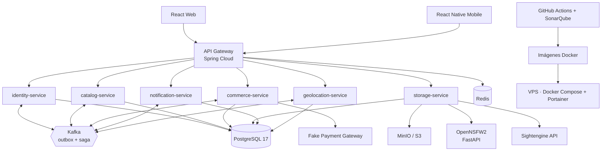
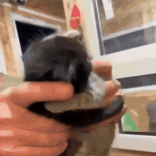

<div align="center">

# 👨‍💻 Cristofer David Lozano Contreras

[](https://git.io/typing-svg)

**Líder de Capysoft** | Neiva, Huila, Colombia 🇨🇴

Tecnólogo en Análisis y Desarrollo de Software (ADSO) · SENA, 2024–2026 · En etapa productiva

[](mailto:cristoferlozano233@gmail.com)
[](https://www.linkedin.com/in/cristofer-lozano-490918385)
[](https://github.com/lozano2303)
[](https://github.com/lozano2303)

</div>

---

## 👨‍💻 Sobre mí

```typescript
const cristofer = {
    ubicacion: "Neiva, Huila 🇨🇴",
    rol: "Backend Developer Junior",
    empresa: "Capysoft (Team Lead)",
    educacion: "ADSO - SENA (2024-2026), en etapa productiva",
    experiencia: ["Tensometálicas"],
    idiomas: ["Español (Nativo)", "Inglés (B1/B2)"],

    practicas: "Diseño de una plataforma para una distribuidora mayorista",

    workflow: [
        "SDD: documento y decido (ADR) antes de construir",
        "TDD: rojo → verde → refactorizar",
        "rama → Liquibase → dominio → infraestructura → aplicación → REST",
        "Validación con Swagger + pruebas end-to-end",
        "IA como herramienta (reviso, pruebo y corrijo)"
    ],

    filosofia: "Entender el porqué arquitectónico antes de implementar",

    actualmente_aprendiendo: ["Kubernetes avanzado", "Observabilidad"],
    dato_curioso: "Mi primer proyecto tenía commits como 'hasheo funcional' 😅"
};
```

<details>
<summary>📈 Experiencia previa</summary>

### Tensometálicas
Experiencia laboral en el sector industrial antes de enfocarme en desarrollo de software.

</details>

---

## 🧭 Cómo trabajo

<table>
<tr>
<td width="50%">

#### 📐 SDD: diseñar antes de construir
- Lo apliqué en **TuEvento** (con el marco SDD del SENA) y lo adapté para el proyecto de mis prácticas
- Documentación por secciones: contexto, dominio, requisitos, arquitectura, datos, API, UML, DevOps, calidad y operación
- Decisiones técnicas registradas como **ADR**, con alternativas evaluadas
- Contratos **OpenAPI**, modelos de datos en **DBML** y diagramas **C4 / Mermaid**
- Matriz de trazabilidad: cada historia de usuario se une con su módulo, sus reglas de negocio, sus eventos y las pruebas que la cubren
- Lo que el negocio no ha confirmado se marca *(por confirmar)*: no se inventan requisitos
- La documentación también pasa CI: contratos, diagramas, modelos y enlaces se validan en cada PR

</td>
<td width="50%">

#### 🧪 TDD: la prueba primero
- Ciclo **rojo → verde → refactorizar** y principios **FIRST**
- **Fakes** en memoria antes que mocks; el tiempo se inyecta con `Clock`
- Pirámide: unitarias (JUnit + AssertJ, Vitest), integración (Testcontainers), contrato contra OpenAPI y pocos E2E
- Carga con **k6** y seguridad con **OWASP ZAP** antes de cada versión
- Cobertura medida con **JaCoCo** en el pipeline

</td>
</tr>
</table>

### 💼 Etapa productiva

Hago mis prácticas diseñando la **plataforma digital de una distribuidora mayorista**: catálogo y cotizaciones para clientes, una app de campo que funciona sin internet y herramientas internas para el equipo comercial.

- Partí de un prototipo estático y lo convertí en un diseño completo con SDD, listo para que la gerencia lo apruebe
- Escogí un **monolito modular** en lugar de microservicios, y lo dejé registrado en un ADR: después de TuEvento, sé cuándo vale la pena separar servicios y cuándo no
- Stack planeado: Java 25, Spring Boot 4, Spring Modulith, PostgreSQL 18, React + Vite y Expo

---

## 🛠️ Stack Tecnológico

<div align="center">

### Backend


-3776AB?style=for-the-badge&logo=python&logoColor=white)


### DevOps & Cloud


### Frontend & Móvil


### Herramientas & Otros


### Del primer año 🎓


</div>

<details>
<summary>🔧 Stack detallado</summary>

#### Backend
- **Java 17** y **Spring Boot 3.5**: 6 microservicios + API Gateway, cada servicio con **DDD hexagonal** (puertos y adaptadores)
- **Spring Cloud Gateway** con circuit breaker (**Resilience4j**)
- **Apache Kafka** para eventos de dominio, con **outbox transaccional** y consumidores idempotentes
- **Spring Security**: JWT **RS256** verificado por JWKS, Refresh Token con rotación, OAuth2 (Google)
- **Redis** para la lista de revocación de tokens
- **WebSocket** (STOMP + SockJS) para sillas en tiempo real
- **PostgreSQL 17** + **Liquibase** (más de 110 changesets), **MySQL** en proyectos del primer año
- **Python + FastAPI** para el servicio de moderación de imágenes

#### DevOps & Infraestructura
- **GitHub Actions**: tests + cobertura JaCoCo + **SonarQube Cloud**, build web y bundle de Expo
- **Jenkins** (Jenkinsfile) y manifiestos de **Kubernetes** (Deployment, Service, Ingress, HPA)
- **Docker Compose** en producción sobre un VPS con **Portainer** y **Nginx Proxy Manager**
- **MinIO** (compatible con S3) con URLs firmadas
- **k6** para pruebas de concurrencia sobre la reserva de sillas
- Versionado semántico con CHANGELOG y tags por release

#### Frontend & Mobile
- **React 18** + **Vite** + **Tailwind CSS 4**, con **Konva** (editor 2D), **Leaflet** (mapas) e **i18next**
- **React Native 0.81** + **Expo 54**, con escaneo de QR desde la cámara
- **Vitest** + Testing Library

#### Primer año ADSO
- **PHP** + **PHPMailer** para backend
- **JavaScript** vanilla para lógica del cliente
- **HTML5**, **CSS3**, **Bootstrap 5** para UI

</details>

---

## 🚀 Proyecto Principal: Tu Evento

<div align="center">

[](https://github.com/lozano2303/TuEvento)
[](https://github.com/lozano2303/TuEvento/tags)
[](https://github.com/lozano2303/TuEvento/commits)
[-brightgreen?style=for-the-badge)](https://github.com/lozano2303/TuEvento)

[](https://github.com/lozano2303/TuEvento/commits)
[](https://github.com/lozano2303/TuEvento/pulls?q=is%3Apr)
[](https://github.com/lozano2303/TuEvento/graphs/contributors)

**Plataforma full-stack de gestión de eventos y venta de boletas**

Desarrollada con **Capysoft** · **6 microservicios Spring Boot 3** con **DDD hexagonal** y **Kafka** · Web **React** · Móvil **React Native + Expo**

Entregada como proyecto final de ADSO en noviembre de 2026 (versión 1.2.1)

</div>

### 🎯 Arquitectura del Proyecto



### 📊 Highlights Técnicos

<table>
<tr>
<td width="50%">

#### 🎨 Frontend
- ✅ Editor visual 2D con Konva
- ✅ Sillas en tiempo real por WebSocket
- ✅ Escaneo de QR desde el móvil
- ✅ 4 idiomas (ES, EN, PT, FR)
- ✅ Temas personalizables

</td>
<td width="50%">

#### ⚙️ Backend
- ✅ 6 microservicios + API Gateway
- ✅ Saga coreografiada con Kafka
- ✅ Outbox transaccional e idempotencia
- ✅ Moderación de imágenes en dos capas
- ✅ Pagos con patrón Strategy

</td>
</tr>
</table>

---

<details>
<summary><b>🧩 De monolito a microservicios</b></summary>

- El backend empezó como un monolito modular y se fue partiendo en **6 servicios**: `identity`, `catalog`, `commerce`, `storage`, `notification` y `geolocation`
- Un **API Gateway** (Spring Cloud) envía cada prefijo de `/api/v1` al servicio dueño, sin ruta comodín
- Ningún servicio lee las tablas de otro: se comunican por APIs internas protegidas y por **eventos de dominio en Kafka**
- Los JWT **RS256** los firma `identity-service` y cada servicio los verifica con su **JWKS**; la revocación vive en **Redis** y falla cerrada

</details>

<details>
<summary><b>🔁 Compra de boletas como saga</b></summary>

- `commerce` crea la orden y le pide a `catalog` reservar las sillas
- Al confirmarse el pago publica `OrderPaid` y `catalog` vende las sillas
- Si la venta falla, `catalog` publica `SeatsSaleRejected` y `commerce` reembolsa el pago
- Las órdenes canceladas o vencidas publican `OrderReleased` y las sillas se liberan
- Eventos escritos con **outbox transaccional** y consumidos de forma idempotente
- Conciliación de pagos pendientes con un job programado

</details>

<details>
<summary><b>🎨 Editor visual 2D de recintos</b></summary>

- Canvas interactivo con **Konva** para diseñar distribuciones de venues
- Drag & drop, selección rubber-band, snap guides, edición de polígonos con vértices Bézier
- Distribución automática de sillas con `distributeSeats`, `computePolygonSeatRows`
- Integrado con el backend para persistir layouts en JSONB

</details>

<details>
<summary><b>⚡ Selección de sillas en tiempo real</b></summary>

- **WebSocket** (STOMP + SockJS) para sincronizar el estado de las sillas entre web y móvil
- Reserva temporal de **10 minutos** con expiración automática vía scheduler (cada 10 seg)
- Carrito con cuenta regresiva en frontend que libera reservas al expirar
- Prueba de carrera con **k6**: varios usuarios reservan la misma silla al mismo tiempo y solo uno la obtiene

</details>

<details>
<summary><b>🎟️ Módulo de tickets</b></summary>

- Órdenes con máquina de estados, generación de QR, check-in y auditoría completa
- Escaneo de QR desde la app móvil; un QR ya usado se detecta y no permite reingreso

</details>

<details>
<summary><b>💳 Pagos con patrón Strategy</b></summary>

- Microservicio **fake-payment-gateway** independiente (Spring Boot, estructura DDD completa)
- Webhooks firmados con **HMAC-SHA256**, idempotencia, reintentos con backoff exponencial
- Diseñado para cambiar a una pasarela real (ej. Wompi) sin tocar la lógica del core

</details>

<details>
<summary><b>💰 Reembolsos y wallet</b></summary>

- Billetera digital con transacciones de recarga, pago, retiro y reembolso
- **Pago mixto wallet + pasarela**: `ChargeOrderViaGatewayUseCase` cobra por la pasarela solo la diferencia
- Ganancias del organizador calculadas en `commerce-service`

</details>

<details>
<summary><b>🛡️ Moderación de imágenes en dos capas</b></summary>

- **OpenNSFW2** autoalojado (FastAPI, TensorFlow 2.16, `opennsfw2==0.13.3`)
- **Sightengine** como segunda capa (gore, desnudos, armas)
- En cascada: OpenNSFW2 primero y Sightengine solo si la imagen pasa la primera etapa; política fail-open ante fallos de infraestructura
- Archivos en **MinIO** con URLs firmadas

</details>

<details>
<summary><b>🔔 Notificaciones, idiomas y temas</b></summary>

- `notification-service`: notificaciones en la app y por correo (SMTP), alimentadas por eventos de Kafka
- Interfaz en **español, inglés, portugués y francés** (web y móvil) y traducción automática de contenido
- Temas light, dark, purple y blue, con personalización por propiedad

</details>

<details>
<summary><b>🧪 Calidad y entrega</b></summary>

- Más de 230 clases de prueba en backend (JUnit + JaCoCo) y pruebas de frontend con Vitest
- Pipeline en GitHub Actions con análisis de SonarQube Cloud
- Releases versionados (v1.0.0 → v1.2.1) con CHANGELOG detallado y notas de despliegue
- Despliegue en VPS con Docker Compose, Portainer y Nginx Proxy Manager
- Manual de usuario, plan de pruebas y matriz de casos de prueba
- Repositorio de documentación SDD aparte: ADR, contratos OpenAPI por servicio, modelo de datos, catálogo de microservicios, matriz de trazabilidad y modelo de amenazas **STRIDE**

</details>

---

### 🔄 De dónde venimos

<table>
<tr>
<td width="50%" align="center">

**Versión Anterior**

[](https://github.com/lozano2303/tu-evento)

Arquitectura básica  
Sin pipeline CI/CD  
Sin DDD

</td>
<td width="50%" align="center">

**Versión Entregada**

[](https://github.com/lozano2303/TuEvento)

**6 microservicios + Gateway**  
**DDD + Hexagonal + Kafka**  
**CI con SonarQube · Deploy en VPS**

</td>
</tr>
</table>

La versión anterior se **reescribió por completo**: primero como monolito modular con **DDD y arquitectura hexagonal**, y después se dividió en **microservicios** que se comunican por Kafka. En el camino se agregó CI con pruebas, cobertura y SonarQube, y un despliegue reproducible con Docker.

> **💡 Nota sobre desarrollo:** TuEvento sigue GitFlow: el trabajo diario va en `develop` y a `main` solo llegan releases. La versión entregada al SENA está marcada con el tag `final-delivery-2026`.

---

## 🎓 Trayectoria

### 🎮 Juego web multijugador (primer año ADSO)

<div align="center">

[](https://github.com/KeinerNarvaez/Proyecto-juego)
[](#)
[](#)

**Exposición:** 📅 6 de diciembre, 2024 | 📍 Cámara de Comercio de Neiva, Huila

</div>

**Tecnologías:** 


<details>
<summary><b>📋 Funcionalidades del juego</b></summary>

- 🔐 Sistema completo de autenticación
- 🎯 Modo solitario con 9 niveles (5 pociones + 4 hechizos)
- 🎮 Salas multijugador (crear y unirse)
- 💬 Chat en tiempo real
- 👤 Sistema de avatares
- 🎵 Audio y música
- 📧 Notificaciones por correo

</details>

### 💼 Mi contribución (14 commits)

<table>
<tr>
<td width="33%" align="center">

**🔐 Autenticación**

✅ Registro con hash  
✅ Activación por correo  
✅ Login seguro  
✅ Recuperación de contraseña  
✅ 2FA con códigos

</td>
<td width="33%" align="center">

**🎮 Modo Solitario**

✅ 5 niveles de pociones  
✅ 4 niveles de hechizos  
✅ Sistema de progresión  
✅ Historial de partidas  
✅ Función "Continuar"

</td>
<td width="33%" align="center">

**🗄️ Base de Datos**

✅ Migración PostgreSQL → MySQL  
✅ 8+ tablas relacionales  
✅ PDO con prepared statements  
✅ Integridad referencial

</td>
</tr>
</table>

<details>
<summary><b>📊 Detalles de mi trabajo</b></summary>

#### Fase 1: Sistema de Autenticación (Sep 28 - Oct 10, 2024)
- Conexión a base de datos con PDO
- Estructura completa de BD (migración PostgreSQL → MySQL)
- Hash de contraseñas con `password_hash()`
- Activación de cuentas por correo
- Integración completa de **PHPMailer** (9,427 líneas agregadas)
- Sistema de login con validación
- Recuperación de contraseñas
- Verificación en dos pasos (2FA)

#### Fase 2: Modo Solitario (Dic 4-5, 2024)
- 9 niveles jugables (5 pociones + 4 hechizos)
- Sistema de progresión persistente
- Historial de mejores puntajes y derrotas
- Gestión de niveles (eliminación, consulta)
- Función "Continuar" desde último nivel jugado
- APIs internas para comunicación frontend-backend

**Total:** ~1,229 líneas netas de código propio (sin contar PHPMailer)

</details>

### 📈 Evolución profesional

#### 🎮 Proyecto del primer año
```php
// Commit: "hasheo funcional"
// login.php: SQL, lógica y HTML en el mismo archivo
$stmt = $pdo->prepare("SELECT * FROM usuarios WHERE correo = ?");
$stmt->execute([$_POST['correo']]);
$user = $stmt->fetch();
if ($user && password_verify($_POST['password'], $user['password'])) {
    echo "<script>location.href='menu.php'</script>";
}
```
❌ Sin arquitectura clara  
❌ Commits poco descriptivos  
❌ Código sin separación de capas

#### 🚀 Tu Evento (entregado)
```java
// identity-service · application/usecase
@Service
@RequiredArgsConstructor
public class RefreshTokenUseCase implements RefreshTokenPort {
    private final RefreshTokenRepository refreshTokenRepository;
    private final AuthSessionRepository  authSessionRepository;
    private final TokenGeneratorPort     tokenGenerator;
    // ...
}
```
✅ **DDD + Hexagonal (puertos in/out)**  
✅ **Conventional commits + PRs + releases**  
✅ **Microservicios con Kafka**

<details>
<summary><b>🔧 Lo que no se ve en los commits</b></summary>
<br>

<div align="center">
  
</div>

#### 📉 La caída
No pasé la sustentación. Mis compañeros de equipo salieron a prácticas y yo volví a empezar en una ficha donde no conocía a nadie. Algunos se burlaron. Me alegraba por mis compañeros, de verdad: hicieron todo lo posible para que saliera con ellos, pero no se pudo. Aun así, por las noches me preguntaba si esto de verdad era para mí, o si solo estaba perdiendo el tiempo.

<p align="right"></p>

#### 🕳️ Cuando toqué fondo
Y cuando pensé que no podía ponerse peor, mi papá casi se nos va. Ahí sí no supe qué hacer. No sabía si iba a volver a ser el mismo, ni cómo íbamos a sostener la casa, ni si tenía sentido seguir estudiando algo que ya me había dejado atrás una vez. Estaba decidido a dejarlo y ponerme a trabajar con mi tío.

> [!IMPORTANT]
> 💬 *"Su papá no quiere eso para usted."*
> — Mi mamá, cuando ella y mi tío me frenaron

Me quedé, pero sin ninguna certeza. Trabajaba con mi tío mientras mi papá se recuperaba de a poco. Lo veía levantarse de la cama para acompañarnos, aunque fuera solo a estar ahí, sintiéndose una carga. Yo me sentía igual. Lloré, no lo voy a negar. Ese año también se alejaron personas que quería, y hubo días en los que no veía para dónde iba nada.

<p align="right"></p>

#### 🔥 Levantarse
Después me fui a trabajar con mi papá de manera independiente. Yo me encargaba de lo pesado mientras él se esforzaba hasta donde el cuerpo le daba. Lo veía ponerse pálido, a punto de caerse, y aun así seguía. En las tardes me iba a estudiar y a sentar las bases de TuEvento sin saber si algún día iba a servir de algo. Lo único que tenía claro era que, si él no se rendía después de algo tan grave, yo tampoco podía.

Con lo que fui ganando le compré la moto a mi tío. Estaba feíta y destartalada, y no faltó quien se burlara de cómo se veía. Dolía, no lo niego, pero era mía y ya no tenía que cruzar la ciudad en bus.

Y mis compañeros del año pasado nunca se fueron del todo. Uno me prestó su computador cuando el de mi casa ya no aguantaba el proyecto. Otro me escuchó cuando le confesé que tenía miedo de perder otra vez. Y otro me ayudó a probar la app y la web cuando ya estaban desplegadas. Estuvieron conmigo hasta el final.

Y en todo el camino tuve a [Jhampier](https://github.com/TheJhampierBoy) al lado. Construimos TuEvento codo a codo, desde la primera línea hasta la entrega.
Los dos teníamos miedo, y aun así lo enfrentamos todo juntos.

<p align="center"><br><sub>🎥 Video: @alpagut552 en TikTok</sub></p>

<p align="right"></p>

#### 📈 La subida
En los últimos meses de la etapa lectiva, la empresa donde hoy hago mis prácticas vio lo que estaba haciendo y decidió patrocinarme. Por primera vez sentí que el esfuerzo, que nunca fue poco, empezaba a dar frutos.

Me demoré un año más, pero llegué mucho más preparado. Y esta vez, Jhampier y yo salimos a prácticas juntos.

<p align="center"><br><sub>🎥 Video de TikTok (créditos en la marca de agua)</sub></p>

<p align="right"></p>

**🔁 Antes → ahora**

| Antes | Ahora |
|:-----:|:-----:|
| 🚌 Cruzando la ciudad en bus | 🏍️ En mi propia moto |
| 🛵 Una moto destartalada | ✨ La misma moto, como nueva |
| 🖥️ Sin computador propio | 💻 Mi propio portátil |
| ❓ Sin saber si iba a terminar | 🏢 Patrocinado y en prácticas |

**📊 Estadísticas de ese año**

| | |
|:--|:--:|
| 🤔 Veces que pensé en rendirme | Muchas |
| 🏳️ Veces que me rendí | **0** |
| 🚌 Veces que crucé la ciudad en bus | Ni idea, demasiadas |
| 🛑 Personas que me frenaron a tiempo | 2 |
| 🤝 Compañeros que siguieron conmigo hasta el final | 3 |
| 👊 Compañero codo a codo en todo el desarrollo | 1, [Jhampier](https://github.com/TheJhampierBoy) |
| 🦾 Ejemplos de verdad en la casa | 1, mi papá |

Y están pasando cosas que en ese momento ni me atrevía a imaginar.

**📜 El changelog de ese año**

```bash
$ git log --oneline --reverse vida/2025-2026
❌ a1c0de1  test: sustentación técnica (FAILED)
🕳️ d0wn404  chore: tocar fondo
💬 9a7e2b3  revert: "dejar el estudio" (mamá y tío)
🔥 f1x3d00  fix: mi papá se levanta, y yo también
🏍️ m0t0f3a  feat: moto destartalada, hoy como nueva
🏢 p4tr0c1  feat: patrocinio de la empresa
🚀 HEAD     release: prácticas en curso
```

---

> [!TIP]
> No lo cuento para dar lástima ni para presumir. Lo cuento para quien esté donde yo estuve, sin saber qué viene: **el menosprecio no es para siempre, y tocar fondo tampoco. Después de tocarlo, lo único que queda es subir.**

<div align="center">

[](https://git.io/typing-svg)

Gracias a Dios y a todas las personas que me apoyaron. 🙏


</div>

</details>

---

## 📊 Estadísticas de GitHub

<div align="center">

<a href="https://github.com/lozano2303">
  
  
</a>


</div>

### 📈 Actividad reciente

<!--START_SECTION:activity-->
<!--END_SECTION:activity-->

<details>
<summary><b>💻 Distribución de código por proyecto</b></summary>

| Proyecto | Rol | Tecnologías principales | Aporte* |
|----------|-----|-------------------------|---------|
| **Tu Evento** | Team Lead & Developer | Spring Boot, Kafka, React, React Native | ~1,380 de ~2,225 commits (≈62%) |
| **Proyecto-juego** | Backend Developer | PHP, MySQL, JavaScript | ~1,229 líneas propias + 9,427 (PHPMailer) |

*Conteos tomados del historial de git de cada repositorio

</details>

---

## 📫 Contacto

<div align="center">

[](mailto:cristoferlozano233@gmail.com)
[](https://github.com/lozano2303)
[](https://www.linkedin.com/in/cristofer-lozano-490918385)

### 💬 Hablemos

**Disponible para colaborar en proyectos de:**
- 🏗️ Arquitectura backend con DDD y Clean Architecture
- 🧩 Microservicios y mensajería con Kafka
- ⚡ Aplicaciones en tiempo real con WebSocket
- 🐳 Infraestructura con Docker y CI/CD

**Zona horaria:** 🌎 UTC-5 (Colombia)

</div>

---

<div align="center">

## 🌍 English Summary

**Backend Developer Junior** | Capysoft Team Lead | Neiva, Colombia 🇨🇴

[](#)
[](#)

### Tech Stack

**Backend:** Java 17 · Spring Boot 3.5 · Spring Cloud Gateway · Apache Kafka · DDD Hexagonal Architecture · Spring Security (RS256 JWT + OAuth2) · PostgreSQL 17 · Redis · Liquibase · WebSocket (STOMP + SockJS)

**DevOps:** Docker · GitHub Actions · SonarQube Cloud · Jenkins · Kubernetes manifests · Portainer · MinIO (S3) · k6

**Frontend & Mobile:** React 18 + Vite + Tailwind · React Native + Expo · Konva (2D graphics) · i18next

### Main Project: Tu Evento

Full-stack event management and ticketing platform built with **Capysoft**, delivered as the SENA final project (v1.2.1, November 2026)

**Key features implemented:**
- 🧩 6 Spring Boot microservices behind a Spring Cloud API Gateway, each one hexagonal DDD
- 🔁 Ticket purchase as a choreographed Kafka saga with a transactional outbox and idempotent consumers
- ⚡ Real-time seat selection with WebSocket + 10-min auto-expiring reservations, race-tested with k6
- 🎨 Visual 2D venue editor with Konva (drag & drop, Bézier polygons, auto seat distribution)
- 💳 Payment gateway with Strategy pattern + HMAC-SHA256 webhooks + idempotency + retry with backoff
- 💰 Digital wallet with mixed payment support (wallet + gateway)
- 🛡️ Two-layer image moderation (OpenNSFW2 self-hosted + Sightengine API)
- 🎟️ Ticketing with QR generation, mobile QR scanning, check-in and audit logs
- 🚀 CI with tests, coverage and SonarQube; versioned releases deployed to a VPS with Docker

**Evolution:** Rewritten from a basic architecture into a hexagonal DDD modular monolith, then split into Kafka-connected microservices

### How I work

**SDD (used in TuEvento and in my internship):** design first, with ADRs, OpenAPI contracts, DBML data models, C4/Mermaid diagrams and a traceability matrix (validated in CI in the internship project) · **TDD:** red → green → refactor, in-memory fakes, Testcontainers for integration

**Internship:** designing the digital platform of a wholesale distributor as a modular monolith (Java 25, Spring Boot 4, PostgreSQL 18)

### Contact

📧 cristoferlozano233@gmail.com | 🔗 [GitHub](https://github.com/lozano2303)

---

<sub>⭐ From [lozano2303](https://github.com/lozano2303) | 📝 README last updated: November 2026</sub>

</div>
